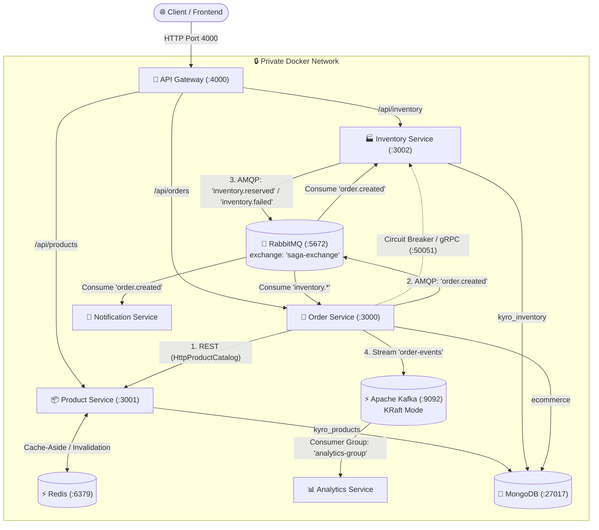
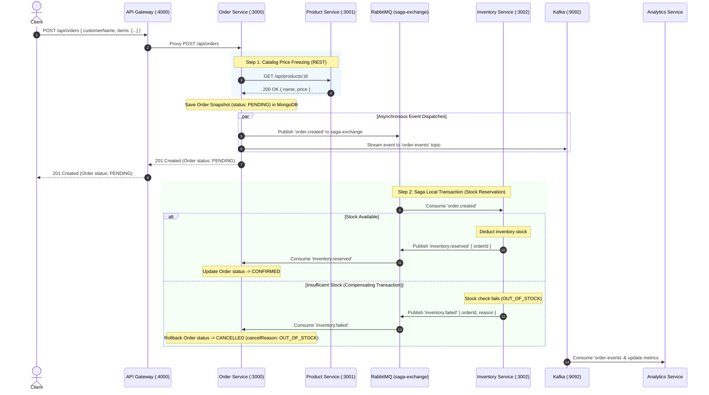

# Kyro — Distributed E-Commerce Microservices Platform

A modern, event-driven, production-grade e-commerce backend platform built with **Node.js**, **Express**, **TypeScript**, and **MongoDB**. The platform implements a multi-protocol hybrid architecture combining an **API Gateway**, **REST APIs**, high-performance **gRPC**, **Redis Caching**, **RabbitMQ** event choreography (**Saga Pattern**), **Circuit Breakers**, and **Apache Kafka** event streaming, all containerized and orchestrated via **Docker Compose**.

---

## 🏗️ Architecture Overview

The system follows **Clean Architecture (Ports & Adapters)**, **Database-per-Service**, and **Event-Driven Architecture (EDA)** patterns. All external client traffic enters through a single, secure **API Gateway** (`:4000`), keeping internal microservices isolated within a private Docker bridge network.



---

## 🔄 End-to-End Order Lifecycle (Distributed Saga Pattern)

Order fulfillment uses an asynchronous **Choreography-based Saga pattern** to maintain data consistency across distributed boundaries without two-phase commit (2PC) locks:



---

## 📦 Microservices & Infrastructure Matrix

| Service / Container | Port(s) | Protocol / Interface | Storage / State | Responsibility |
| :--- | :--- | :--- | :--- | :--- |
| **`api-gateway`** | **`4000`** *(Public)* | HTTP (Reverse Proxy) | Stateless | Single public entry point; routes `/api/*`, applies auth validation, handles CORS. |
| **`order-service`** | `3000` *(Internal)* | REST / AMQP / Kafka | MongoDB (`ecommerce`) | Orchestrates orders, locks price snapshots, coordinates the Saga workflow. |
| **`product-service`** | `3001` *(Internal)* | REST API (JSON) | MongoDB (`kyro_products`) + Redis | Manages product catalog with Redis cache-aside and automatic invalidation. |
| **`inventory-service`** | `3002` (REST)<br>`50051` (gRPC) | REST API & gRPC Server | MongoDB (`kyro_inventory`) | Manages warehouse stock, handles Saga reservation events, exposes gRPC check. |
| **`notification-service`** | Worker | AMQP 0-9-1 Consumer | Stateless | Consumes order events from RabbitMQ and triggers customer email notifications. |
| **`analytics-service`** | Worker | Kafka Consumer | MongoDB (`ecommerce_analytics`) | Consumes `order-events` stream from Kafka to compute live revenue and order stats. |
| **`redis`** | `6379` *(Host/Internal)* | Redis Protocol | In-Memory (Redis 7) | High-speed cache for product queries with TTL and cache eviction. |
| **`rabbitmq`** | `5672` (AMQP)<br>`15672` (UI) | AMQP & HTTP UI | Persistent Queues | Topic exchange message broker driving Saga choreography. |
| **`kafka`** | `9092` *(Host/Internal)* | Kafka Protocol | Commit Log | High-throughput distributed event streaming in KRaft mode (no ZooKeeper). |
| **`mongo`** | `27017` *(Host/Internal)* | MongoDB Wire | Named Volume (`kyro-mongo-data`) | Multi-database persistence (`ecommerce`, `kyro_products`, `kyro_inventory`). |

---

## ⚡ Core Patterns & Resiliency

### 1. Unified API Gateway (`api-gateway`)
- Operates as a reverse proxy using `http-proxy-middleware`.
- External traffic connects exclusively to `http://localhost:4000`:
  - `/api/products` $\rightarrow$ `http://product-service:3001`
  - `/api/inventory` $\rightarrow$ `http://inventory-service:3002`
  - `/api/orders` $\rightarrow$ `http://order-service:3000`
- Internal service ports (`3000`, `3001`, `3002`) remain shielded from the host for security.
- Contains authentication middleware supporting bearer token authorization with permissive development fallbacks.

### 2. Redis Cache-Aside Pattern (`product-service`)
- Product lookups by ID first check Redis cache (`product:<productId>`).
- **Cache Hit**: Returns cached JSON instantly without querying MongoDB.
- **Cache Miss**: Queries MongoDB, populates Redis with a 1-hour expiration (TTL: 3600s), and returns data.
- **Cache Invalidation**: Updating (`PATCH`) or deleting (`DELETE`) a product automatically purges the corresponding cache key.

### 3. Distributed Saga Pattern with Compensating Transactions
- Instead of distributed locks, orders begin in a `PENDING` state.
- **Happy Path**: Stock deduction succeeds $\rightarrow$ emits `inventory.reserved` $\rightarrow$ Order updates to `CONFIRMED`.
- **Compensating Path**: Stock deduction fails $\rightarrow$ emits `inventory.failed` $\rightarrow$ Order automatically updates to `CANCELLED` with `cancelReason: "OUT_OF_STOCK"`.

### 4. Circuit Breaker (`order-service`)
- Inter-service gRPC stock checks are wrapped with an **Opossum** Circuit Breaker (`inventory.circuit-breaker.ts`).
- Configured with a `3000ms` timeout, `50%` failure threshold, and a `10000ms` reset timeout to fail fast during inventory downtime.

### 5. Event Streaming (`analytics-service`)
- Real-time orders are streamed to Apache Kafka's `order-events` topic.
- The Analytics Service processes events with consumer group `analytics-group`, providing decoupled metric aggregation.

---

## 📁 Repository Structure

```
kyro/
├── docker-compose.yml                   # Container stack: 6 Microservices + Mongo + Redis + RabbitMQ + Kafka
├── package.json                         # Monorepo root build and dev scripts
├── README.md                            # Comprehensive system documentation
│
└── services/
    ├── api-gateway/                     # Gateway (Port 4000)
    │   ├── Dockerfile
    │   ├── package.json
    │   ├── tsconfig.json
    │   └── src/
    │       ├── middlewares/
    │       │   └── auth.middleware.ts   # Request logging & Bearer token auth guard
    │       ├── routes/
    │       │   └── gateway.routes.ts    # Proxy route declarations
    │       ├── app.ts
    │       └── server.ts
    │
    ├── order-service/                   # Order Microservice (Port 3000)
    │   ├── Dockerfile
    │   ├── package.json
    │   ├── tsconfig.json
    │   ├── protos/
    │   │   └── inventory.proto          # gRPC contract
    │   └── src/
    │       ├── config/db.ts             # MongoDB connection ('ecommerce')
    │       ├── brokers/
    │       │   ├── saga.consumer.ts     # Listens to 'inventory.*' (Confirm/Rollback)
    │       │   ├── rabbitmq.client.ts   # Emits 'order.created'
    │       │   └── kafka.client.ts      # Streams to 'order-events'
    │       ├── clients/
    │       │   ├── http-product.client.ts       # REST client for catalog price lock
    │       │   ├── grpc-inventory.client.ts     # gRPC client for inventory check
    │       │   └── inventory.circuit-breaker.ts # Opossum circuit breaker wrapper
    │       ├── modules/orders/
    │       │   ├── order.model.ts       # Mongoose Schema (PENDING / CONFIRMED / CANCELLED)
    │       │   ├── order.service.ts     # Core domain logic
    │       │   ├── order.controller.ts
    │       │   └── order.route.ts
    │       ├── app.ts
    │       └── server.ts
    │
    ├── product-service/                 # Product Microservice (Port 3001)
    │   ├── Dockerfile
    │   ├── package.json
    │   ├── tsconfig.json
    │   └── src/
    │       ├── config/db.ts             # MongoDB connection ('kyro_products')
    │       ├── clients/
    │       │   └── redis.client.ts      # Redis connection & cache manager
    │       ├── modules/products/
    │       │   ├── product.model.ts
    │       │   ├── product.service.ts   # Cache-aside lookup & invalidation
    │       │   ├── product.controller.ts
    │       │   └── product.route.ts
    │       ├── app.ts
    │       └── server.ts
    │
    ├── inventory-services/              # Inventory Microservice (Port 3002 & 50051)
    │   ├── Dockerfile
    │   ├── package.json
    │   ├── tsconfig.json
    │   ├── protos/
    │   │   └── inventory.proto
    │   └── src/
    │       ├── config/db.ts             # MongoDB connection ('kyro_inventory')
    │       ├── brokers/
    │       │   ├── rabbitmq.consumer.ts # Consumes 'order.created' & reserves stock
    │       │   └── rabbitmq.publisher.ts# Emits 'inventory.reserved' / 'failed'
    │       ├── servers/
    │       │   └── grpc.server.ts       # gRPC server on port 50051
    │       ├── modules/inventory/
    │       │   ├── inventory.model.ts
    │       │   ├── inventory.service.ts
    │       │   ├── inventory.controller.ts
    │       │   └── inventory.route.ts
    │       ├── app.ts
    │       └── server.ts
    │
    ├── notification-service/            # RabbitMQ Consumer Worker
    │   ├── Dockerfile
    │   ├── package.json
    │   ├── tsconfig.json
    │   └── src/
    │       ├── config/mailer.ts         # Email dispatcher simulation
    │       ├── brokers/
    │       │   └── rabbitmq.consumer.ts # Listens for order events
    │       ├── modules/notifications/
    │       │   └── notification.service.ts
    │       └── server.ts
    │
    └── analytics-service/               # Kafka Stream Consumer Worker
        ├── Dockerfile
        ├── package.json
        ├── tsconfig.json
        └── src/
            ├── config/db.ts
            ├── brokers/
            │   └── kafka.consumer.ts    # Consumes 'order-events'
            ├── modules/analytics/
            │   ├── analytics.model.ts
            │   └── analytics.controller.ts
            └── server.ts
```

---

## 🚀 Getting Started

### Prerequisites
- [Docker](https://www.docker.com/) & Docker Compose
- [Node.js](https://nodejs.org/) (v20+) & npm *(for optional local dev outside containers)*

---

### Running the Entire Platform

1. **Build and launch all services**:
   ```bash
   docker compose up --build -d
   ```

2. **Verify running containers**:
   ```bash
   docker compose ps
   ```

3. **Check Gateway and Management Dashboards**:
   - **API Gateway Health:** `curl http://localhost:4000/health`
   - **RabbitMQ Management Dashboard:** [http://localhost:15672](http://localhost:15672) *(Credentials: `admin` / `admin`)*
   - **Redis CLI:** `docker compose exec redis redis-cli ping` (returns `PONG`)
   - **Kafka Broker:** `localhost:9092` *(KRaft mode)*

4. **Monitor Real-Time Logs**:
   ```bash
   # Saga & Order logs
   docker compose logs -f order-service inventory-service

   # Background workers
   docker compose logs -f notification-service analytics-service
   ```

5. **Stop the stack**:
   ```bash
   docker compose down
   # To clear database volumes:
   docker compose down -v
   ```

---

## 📬 API Reference & Verification Guide (via API Gateway `:4000`)

All API requests must be routed through `http://localhost:4000`.

### 1. API Gateway
- `GET /health` — Check Gateway status

```bash
curl -X GET http://localhost:4000/health
```

---

### 2. Product Catalog (`/api/products`)

| Method | Endpoint | Description |
| :--- | :--- | :--- |
| `POST` | `/api/products` | Create a new product |
| `GET` | `/api/products` | List all products |
| `GET` | `/api/products/:id` | Get single product (utilizes Redis caching) |
| `PATCH` | `/api/products/:id` | Update product details (invalidates Redis cache) |
| `DELETE` | `/api/products/:id` | Remove a product (invalidates Redis cache) |

#### Example Commands:

```bash
# 1. Create a product
curl -X POST http://localhost:4000/api/products \
  -H "Content-Type: application/json" \
  -d '{
    "name": "Nike Air Zoom",
    "description": "High performance running shoe",
    "price": 249,
    "stock": 50
  }'

# 2. Get product by ID (1st call: Cache Miss; 2nd call: Cache Hit)
curl -X GET http://localhost:4000/api/products/<PRODUCT_ID>

# 3. Update product (clears Redis cache)
curl -X PATCH http://localhost:4000/api/products/<PRODUCT_ID> \
  -H "Content-Type: application/json" \
  -d '{ "price": 299 }'

# 4. Delete product
curl -X DELETE http://localhost:4000/api/products/<PRODUCT_ID>
```

---

### 3. Inventory Management (`/api/inventory`)

| Method | Endpoint | Description |
| :--- | :--- | :--- |
| `POST` | `/api/inventory` | Initialize inventory for a product |
| `GET` | `/api/inventory` | List all inventory items |
| `GET` | `/api/inventory/:id` | Retrieve record by Inventory `_id` OR `productId` |
| `PATCH` | `/api/inventory/:id` | Update stock, reserved, or location |
| `DELETE` | `/api/inventory/:id` | Remove inventory record |

#### Example Commands:

```bash
# 1. Initialize warehouse stock for a product
curl -X POST http://localhost:4000/api/inventory \
  -H "Content-Type: application/json" \
  -d '{
    "productId": "<PRODUCT_ID>",
    "sku": "NIKE-AIR-001",
    "stock": 50,
    "reserved": 0,
    "location": "Warehouse-North"
  }'

# 2. Query inventory by product ID
curl -X GET http://localhost:4000/api/inventory/<PRODUCT_ID>

# 3. Update stock levels
curl -X PATCH http://localhost:4000/api/inventory/<INVENTORY_ID_OR_PRODUCT_ID> \
  -H "Content-Type: application/json" \
  -d '{ "stock": 100 }'
```

---

### 4. Orders & Distributed Saga (`/api/orders`)

| Method | Endpoint | Description |
| :--- | :--- | :--- |
| `POST` | `/api/orders` | Place order (triggers Saga stock reservation via RabbitMQ & stream to Kafka) |
| `GET` | `/api/orders` | List customer orders (sorted newest first) |
| `GET` | `/api/orders/:id` | Get specific order state (`PENDING`, `CONFIRMED`, `CANCELLED`) |
| `PATCH` | `/api/orders/:id/status` | Update status (`pending`, `confirmed`, `cancelled`) |
| `DELETE` | `/api/orders/:id` | Delete an order |

#### Example Commands:

```bash
# 1. Place an order (Success Flow: In-Stock)
curl -X POST http://localhost:4000/api/orders \
  -H "Content-Type: application/json" \
  -d '{
    "customerName": "Jane Doe",
    "items": [
      {
        "productId": "<PRODUCT_ID>",
        "quantity": 2
      }
    ]
  }'
# Response: 201 Created with status "PENDING"
# Within milliseconds, RabbitMQ reserves stock and the order updates to "CONFIRMED".

# 2. Check Order Status
curl -X GET http://localhost:4000/api/orders/<ORDER_ID>
# Status will be "CONFIRMED" and inventory stock will decrease by 2.

# 3. Place an order exceeding available stock (Compensating Flow: Out-of-Stock)
curl -X POST http://localhost:4000/api/orders \
  -H "Content-Type: application/json" \
  -d '{
    "customerName": "John Doe",
    "items": [
      {
        "productId": "<PRODUCT_ID>",
        "quantity": 999999
      }
    ]
  }'

# 4. Verify Compensating Transaction
curl -X GET http://localhost:4000/api/orders/<ORDER_ID>
# Status transitions automatically to "CANCELLED" with cancelReason: "OUT_OF_STOCK".
```
