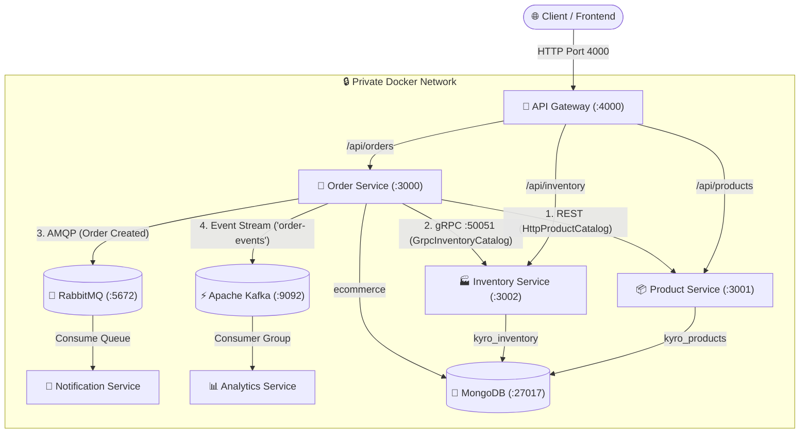
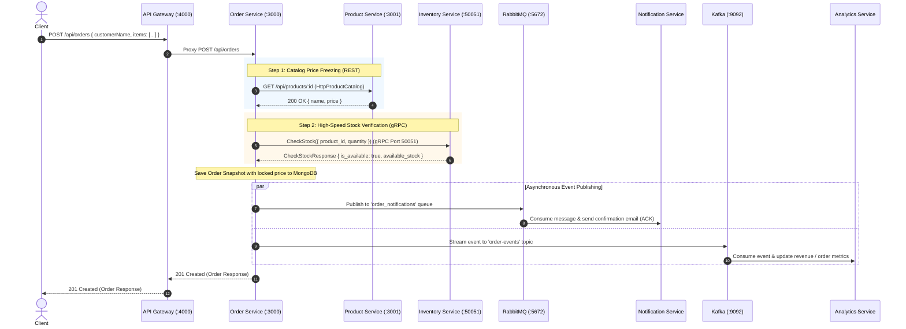

# Kyro — Distributed E-Commerce Microservices Platform

A modern, event-driven, production-grade e-commerce backend monorepo built with **Node.js**, **Express 5**, **TypeScript**, and **MongoDB**. The platform implements a multi-protocol hybrid architecture combining **API Gateway routing**, **REST APIs**, high-performance **gRPC**, **RabbitMQ** message queuing, and **Apache Kafka** event streaming, all containerized and orchestrated via **Docker Compose**.

---

## 🏗️ Architecture Overview

The system follows **Clean Architecture (Ports & Adapters)**, **Database-per-Service**, and **Event-Driven Architecture (EDA)** patterns. All client traffic enters through a single, secure **API Gateway**, keeping domain microservices completely isolated within the private Docker bridge network.



---

## 🔄 End-to-End Order Lifecycle Flow



---

## 📦 Microservices & Infrastructure Matrix

| Service / Container | Port(s) | Protocol / Interface | Database / Storage | Responsibility |
| :--- | :--- | :--- | :--- | :--- |
| **`api-gateway`** | **`4000`** *(Public)* | HTTP (Reverse Proxy) | Stateless | Single entry point for external clients; route forwarding & CORS handling. |
| **`order-service`** | `3000` *(Internal)* | REST / AMQP / Kafka / gRPC Client | MongoDB (`ecommerce`) | Orchestrates checkout, freezes price snapshots, updates order states. |
| **`product-service`** | `3001` *(Internal)* | REST API (JSON) | MongoDB (`kyro_products`) | Manages product catalog, metadata, baseline pricing, and descriptions. |
| **`inventory-service`** | `3002` (REST)<br>`50051` (gRPC) | REST API & gRPC Server | MongoDB (`kyro_inventory`) | Tracks physical warehouse stock, reserved allocations, and SKUs. |
| **`notification-service`**| Worker | AMQP 0-9-1 Consumer | Stateless | Consumes order notification queue from RabbitMQ and dispatches customer alerts. |
| **`analytics-service`** | Worker | Kafka Consumer | In-Memory / Stream State | Consumes `order-events` topic from Kafka; computes live revenue and order metrics. |
| **`rabbitmq`** | `5672` (AMQP)<br>`15672` (UI) | AMQP & HTTP Management | Message Queues | Durable message broker with automatic queue assertion and delivery acknowledgments. |
| **`kafka`** | `9092` | Apache Kafka (KRaft mode) | Commit Log | High-throughput distributed event streaming without ZooKeeper dependency. |
| **`mongo`** | `27017` | MongoDB Wire Protocol | Persistent Volume | Multi-database persistence (`ecommerce`, `kyro_products`, `kyro_inventory`). |

---

## ⚡ Inter-Service Communication Patterns

### 1. Unified API Gateway (`api-gateway`)
- Operates as a reverse proxy using `http-proxy-middleware`.
- External traffic calls `http://localhost:4000`. The gateway routes:
  - `/api/orders` $\rightarrow$ `http://order-service:3000`
  - `/api/products` $\rightarrow$ `http://product-service:3001`
  - `/api/inventory` $\rightarrow$ `http://inventory-service:3002`
- Internal service ports are shielded from the public host network.

### 2. Synchronous REST Abstraction Barrier (`HttpProductCatalog`)
- The Order Service does **not** connect directly to the product database.
- It accesses catalog data through the typed `ProductCatalog` interface adapter (`http-product-catalog.ts`), making internal HTTP requests to the Product Service to resolve item names and lock in unit prices.

### 3. Synchronous High-Performance gRPC (`GrpcInventoryCatalog`)
- Stock availability checks during checkout use binary **Protocol Buffers** over HTTP/2.
- Exposes RPC endpoint `CheckStock` on port `50051`, offering low-latency, strictly-typed validation.

### 4. Asynchronous Task Queue (**RabbitMQ**)
- Order creation emits an event to the durable queue `order_notifications`.
- The **Notification Service** consumes messages, logs email confirmations, and sends an explicit `channel.ack(msg)` to ensure zero message loss.

### 5. Distributed Event Streaming (**Apache Kafka**)
- Order creation events are published to the `order-events` topic using `kafkajs`.
- The **Analytics Service** operates as part of the `analytics-group` consumer group with `fromBeginning: true`, computing real-time metrics for total orders and gross revenue.

---

## 📜 Protocol Buffers Definition (`inventory.proto`)

```protobuf
syntax = "proto3";

package inventory;

service InventoryService {
  rpc GetInventory (GetInventoryRequest) returns (InventoryResponse);
  rpc CheckStock (CheckStockRequest) returns (CheckStockResponse);
  rpc UpdateStock (UpdateStockRequest) returns (InventoryResponse);
}

message GetInventoryRequest {
  string product_id = 1;
}

message CheckStockRequest {
  string product_id = 1;
  int32 quantity = 2;
}

message CheckStockResponse {
  string product_id = 1;
  bool is_available = 2;
  int32 available_stock = 3;
}

message UpdateStockRequest {
  string product_id = 1;
  int32 stock = 2;
  int32 reserved = 3;
}

message InventoryResponse {
  string id = 1;
  string product_id = 2;
  string sku = 3;
  int32 stock = 4;
  int32 reserved = 5;
  int32 available_stock = 6;
  string location = 7;
}
```

---

## 📁 Repository Structure

```
kyro/
├── compose.yaml                         # Docker Compose: 6 Microservices + Mongo + RabbitMQ + Kafka
├── package.json                         # Monorepo root scripts
├── test.http                            # Ready-to-run REST Client tests for all services
├── README.md                            # Complete system documentation
│
└── services/
    ├── api-gateway/                     # API Gateway (Port 4000)
    │   ├── Dockerfile
    │   ├── package.json
    │   └── server.ts                    # Reverse proxy routing rules
    │
    ├── order-service/                   # Order Microservice (Port 3000)
    │   ├── Dockerfile
    │   ├── package.json
    │   ├── tsconfig.json
    │   ├── protos/
    │   │   └── inventory.proto          # gRPC contract definition
    │   └── src/
    │       ├── config/db.ts             # MongoDB connection ('ecommerce')
    │       ├── modules/orders/
    │       │   ├── adapters/            # Ports & Adapters Layer
    │       │   │   ├── product-catalog.ts        (Interface)
    │       │   │   ├── http-product-catalog.ts   (REST Adapter)
    │       │   │   ├── inventory-catalog.ts      (Interface)
    │       │   │   ├── grpc-inventory-catalog.ts (gRPC Adapter)
    │       │   │   ├── rabbitmq-client.ts        (AMQP Publisher)
    │       │   │   └── kafka-client.ts           (Kafka Producer)
    │       │   ├── order.model.ts       # Mongoose Schema
    │       │   ├── order.service.ts     # Core domain orchestration
    │       │   ├── order.controller.ts
    │       │   └── order.route.ts
    │       ├── app.ts
    │       └── server.ts
    │
    ├── product-service/                 # Product Microservice (Port 3001)
    │   ├── Dockerfile
    │   ├── package.json
    │   ├── tsconfig.json
    │   └── src/
    │       ├── config/db.ts             # MongoDB connection ('kyro_products')
    │       ├── modules/products/
    │       │   ├── product.model.ts
    │       │   ├── product.service.ts
    │       │   ├── product.controller.ts
    │       │   └── product.route.ts
    │       └── server.ts
    │
    ├── inventory-services/              # Inventory Microservice (Port 3002 & 50051)
    │   ├── Dockerfile
    │   ├── package.json
    │   ├── tsconfig.json
    │   ├── protos/
    │   │   └── inventory.proto          # gRPC contract definition
    │   └── src/
    │       ├── config/db.ts             # MongoDB connection ('kyro_inventory')
    │       ├── grpc/
    │       │   └── grpc.server.ts       # gRPC server implementation on port 50051
    │       ├── modules/inventory/
    │       │   ├── inventory.model.ts
    │       │   ├── inventory.service.ts
    │       │   ├── inventory.controller.ts
    │       │   └── inventory.route.ts
    │       └── server.ts                # Boots Express (3002) + gRPC (50051)
    │
    ├── notification-service/            # RabbitMQ Consumer Worker
    │   ├── Dockerfile
    │   ├── package.json
    │   └── server.ts                    # Listens to 'order_notifications' queue
    │
    └── analytics-service/               # Kafka Event Consumer Worker
        ├── Dockerfile
        ├── package.json
        ├── server.ts
        └── adapters/
            └── kafka-consumer.ts        # Subscribes to 'order-events' & aggregates metrics
```

---

## 🚀 Getting Started

### Prerequisites
- [Docker](https://www.docker.com/) & Docker Compose
- [Node.js](https://nodejs.org/) (v22+) & npm *(for local development)*

---

### Running with Docker (Recommended)

1. **Build and launch all services**:
   ```bash
   docker compose up --build -d
   ```

2. **Verify all containers are running and healthy**:
   ```bash
   docker compose ps
   ```

3. **Check Gateway and Management Dashboards**:
   - **API Gateway Health:** `curl http://localhost:4000/health`
   - **RabbitMQ Management Dashboard:** [http://localhost:15672](http://localhost:15672) *(Credentials: `admin` / `admin`)*
   - **Kafka Broker:** `localhost:9092` *(KRaft mode)*

4. **Stream Real-Time Worker Logs**:
   ```bash
   # Notification Service (RabbitMQ logs)
   docker compose logs -f notification-service

   # Analytics Service (Kafka revenue stream)
   docker compose logs -f analytics-service
   ```

5. **Tear down the environment**:
   ```bash
   docker compose down
   # To remove persistent database volumes as well:
   docker compose down -v
   ```

---

## 📬 Unified API Endpoints (Via API Gateway `:4000`)

All client requests should be routed through **`http://localhost:4000`**:

### 1. Product Catalog (`/api/products`)

| Method | Endpoint | Description |
| :--- | :--- | :--- |
| `POST` | `/api/products` | Create a new product item |
| `GET` | `/api/products` | Retrieve catalog with pagination & search |
| `GET` | `/api/products/:id` | Get single product by MongoDB ID |
| `PATCH`| `/api/products/:id` | Update product price or details |
| `DELETE`| `/api/products/:id` | Remove a product |

### 2. Inventory Management (`/api/inventory`)

| Method | Endpoint | Description |
| :--- | :--- | :--- |
| `POST` | `/api/inventory` | Initialize warehouse stock for a product |
| `GET` | `/api/inventory` | List all inventory records |
| `GET` | `/api/inventory/:id` | Get stock by Inventory ID or Product ID |
| `PATCH`| `/api/inventory/:id` | Update warehouse stock or reserved quantities |
| `DELETE`| `/api/inventory/:id` | Remove inventory record |

### 3. Orders & Checkout (`/api/orders`)

| Method | Endpoint | Description |
| :--- | :--- | :--- |
| `POST` | `/api/orders` | Create an order (validates catalog via REST, verifies stock via gRPC, publishes to RabbitMQ & Kafka) |
| `GET` | `/api/orders` | List customer orders (sorted latest first) |
| `GET` | `/api/orders/:id` | Get specific order details with frozen price snapshot |
| `PATCH`| `/api/orders/:id/status` | Transition order status (`pending`, `confirmed`, `cancelled`) |

---

## 🧪 Testing the Complete Workflow

You can run these requests directly in VS Code using the **REST Client** extension via [`test.http`](file:///Users/rabeeh/kyro/test.http), or test them directly against the **API Gateway** (`http://localhost:4000`):

### 1. Create a Product
```http
POST http://localhost:4000/api/products
Content-Type: application/json

{
  "name": "Nike Airforce 1",
  "description": "Classic leather casual sneaker",
  "price": 2999,
  "stock": 50
}
```
*Note the returned `_id`.*

---

### 2. Initialize Warehouse Stock
```http
POST http://localhost:4000/api/inventory
Content-Type: application/json

{
  "productId": "<PRODUCT_ID>",
  "sku": "NIKE-AIR-001",
  "stock": 50,
  "reserved": 0,
  "location": "Warehouse-North"
}
```

---

### 3. Place an Order (Triggers Full Hybrid Pipeline)
```http
POST http://localhost:4000/api/orders
Content-Type: application/json

{
  "customerName": "Alex Mercer",
  "items": [
    {
      "productId": "<PRODUCT_ID>",
      "quantity": 2
    }
  ]
}
```

---

### 4. Verify Asynchronous Events in Logs

Immediately after placing the order, inspect your Docker container logs:

* **Notification Service:**
  ```text
  Notification Service waiting for messages in [order_notifications]...
  📧 [EMAIL SENT] Order Confirmation to: Alex Mercer
  📦 Order Details: [ { productId: '...', productName: 'Nike Airforce 1', quantity: 2, unitPrice: 2999 } ]
  ```

* **Analytics Service:**
  ```text
  ✅ Analytics Service connected to Kafka
  📊 [ANALYTICS UPDATE] New event on order-events!
  📈 Total Orders to Date : 1
  💰 Total Gross Revenue  : $5998
  ```
