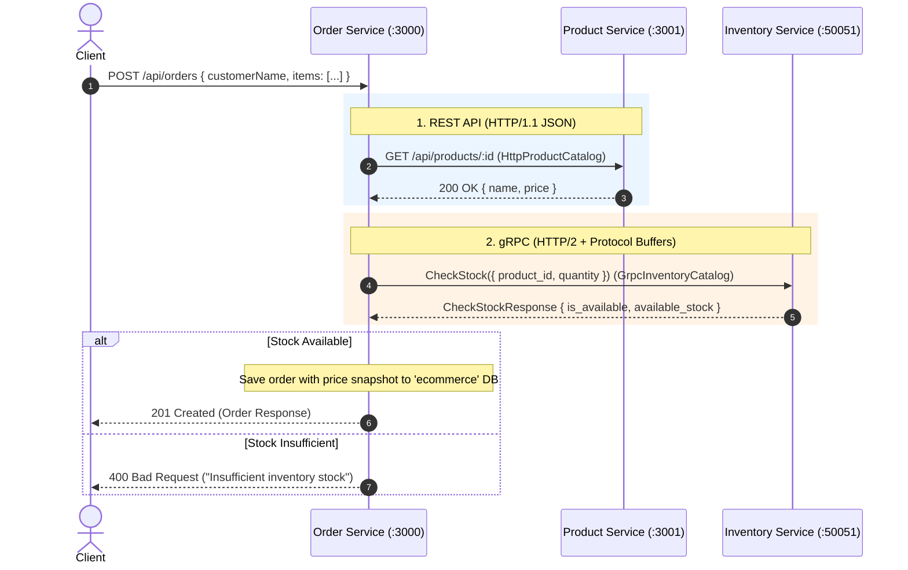

# Kyro — E-Commerce Microservices Platform

A modern, scalable e-commerce backend built with **Node.js**, **Express**, **TypeScript**, and **MongoDB**, featuring a hybrid communication model (**REST API** and **gRPC**) orchestrated with **Docker Compose**.

---

## 🏗️ Architecture Overview

The system is organized as a monorepo consisting of three independent microservices following the **Database-per-Service** and **Ports & Adapters (Clean Architecture)** patterns:



---

## 📦 Services

| Service | Port(s) | Database | Role & Description |
| :--- | :--- | :--- | :--- |
| **`order-service`** | `3000` | `ecommerce` | Handles order placement, status tracking, item snapshotting, and coordinates cross-service requests. |
| **`product-service`** | `3001` | `kyro_products` | Manages the product catalog, pricing, descriptions, and metadata. |
| **`inventory-service`** | `3002` (HTTP)<br>`50051` (gRPC) | `kyro_inventory` | Manages physical warehouse stock, allocations, reserved quantities, and exposes gRPC RPC endpoints. |
| **`mongo`** | `27017` | *Shared Instance* | Isolated logical databases per service with healthcheck monitoring. |

---

## ⚡ Inter-Service Communication

### 1. Order Service $\rightarrow$ Product Service (**REST API**)
- **Protocol**: HTTP/1.1 with JSON payloads.
- **Client Adapter**: `HttpProductCatalog` implements `ProductCatalog`.
- **Purpose**: Order Service fetches current product details and freezes unit prices at the time of purchase (price snapshotting).

### 2. Order Service $\rightarrow$ Inventory Service (**gRPC**)
- **Protocol**: HTTP/2 with binary Protocol Buffers (`inventory.proto`).
- **Client Adapter**: `GrpcInventoryCatalog` implements `InventoryCatalog`.
- **Server**: gRPC server on port `50051` using `@grpc/grpc-js` and `@grpc/proto-loader`.
- **Purpose**: High-performance, strongly-typed stock availability checks and stock reservations during order placement.

---

## 📜 Protocol Buffers (`inventory.proto`)

```protobuf
syntax = "proto3";

package inventory;

service InventoryService {
  rpc GetInventory (GetInventoryRequest) returns (InventoryResponse);
  rpc CheckStock (CheckStockRequest) returns (CheckStockResponse);
  rpc UpdateStock (UpdateStockRequest) returns (InventoryResponse);
}

message GetInventoryRequest {
  string product_id = 1;
}

message CheckStockRequest {
  string product_id = 1;
  int32 quantity = 2;
}

message CheckStockResponse {
  string product_id = 1;
  bool is_available = 2;
  int32 available_stock = 3;
}

message UpdateStockRequest {
  string product_id = 1;
  int32 stock = 2;
  int32 reserved = 3;
}

message InventoryResponse {
  string id = 1;
  string product_id = 2;
  string sku = 3;
  int32 stock = 4;
  int32 reserved = 5;
  int32 available_stock = 6;
  string location = 7;
}
```

---

## 📁 Repository Structure

```
kyro/
├── compose.yaml                      # Multi-container orchestration (Order, Product, Inventory, Mongo)
├── package.json                      # Workspace scripts for monorepo development
├── test.http                         # Ready-to-run REST Client tests for all services
├── README.md
│
└── services/
    ├── order-service/                # Order Microservice (Port 3000)
    │   ├── Dockerfile
    │   ├── package.json
    │   ├── tsconfig.json
    │   ├── protos/
    │   │   └── inventory.proto       # gRPC contract definition
    │   └── src/
    │       ├── config/db.ts          # MongoDB connection ('ecommerce')
    │       ├── modules/orders/
    │       │   ├── adapters/         # Ports & Adapters Layer
    │       │   │   ├── product-catalog.ts        (Interface)
    │       │   │   ├── http-product-catalog.ts   (REST Adapter)
    │       │   │   ├── inventory-catalog.ts      (Interface)
    │       │   │   └── grpc-inventory-catalog.ts (gRPC Adapter)
    │       │   ├── order.model.ts    # Mongoose Schema
    │       │   ├── order.service.ts  # Core domain logic
    │       │   ├── order.controller.ts
    │       │   └── order.route.ts
    │       ├── app.ts
    │       └── server.ts
    │
    ├── product-service/              # Product Microservice (Port 3001)
    │   ├── Dockerfile
    │   ├── package.json
    │   ├── tsconfig.json
    │   └── src/
    │       ├── config/db.ts          # MongoDB connection ('kyro_products')
    │       ├── modules/products/
    │       │   ├── product.model.ts
    │       │   ├── product.service.ts
    │       │   ├── product.controller.ts
    │       │   └── product.route.ts
    │       └── server.ts
    │
    └── inventory-services/           # Inventory Microservice (Port 3002 & 50051)
        ├── Dockerfile
        ├── package.json
        ├── tsconfig.json
        ├── protos/
        │   └── inventory.proto       # gRPC contract definition
        └── src/
            ├── config/db.ts          # MongoDB connection ('kyro_inventory')
            ├── grpc/
            │   └── grpc.server.ts    # gRPC server implementation on port 50051
            ├── modules/inventory/
            │   ├── inventory.model.ts
            │   ├── inventory.service.ts
            │   ├── inventory.controller.ts
            │   └── inventory.route.ts
            └── server.ts             # Starts Express (3002) + gRPC (50051)
```

---

## 🚀 Getting Started

### Prerequisites
- [Docker](https://www.docker.com/) & Docker Compose
- [Node.js](https://nodejs.org/) (v22+) & npm

---

### Running with Docker (Recommended)

1. **Clone and start all services**:
   ```bash
   docker compose up --build -d
   ```

2. **Verify container health**:
   ```bash
   docker compose ps
   ```

3. **Check health endpoints**:
   ```bash
   curl http://localhost:3000/health   # Order Service
   curl http://localhost:3001/health   # Product Service
   curl http://localhost:3002/health   # Inventory Service
   ```

4. **Stop the services**:
   ```bash
   docker compose down
   ```

---

### Running Locally (Without Docker)

1. **Ensure a local MongoDB instance is running on port `27017`**:
   ```bash
   mongod --dbpath /path/to/data
   ```

2. **Build all services from workspace root**:
   ```bash
   npm run build
   ```

3. **Run services in development mode**:
   ```bash
   # In terminal 1 (Product Service)
   npm run dev:product

   # In terminal 2 (Inventory Service)
   npm run dev:inventory

   # In terminal 3 (Order Service)
   npm run dev:order
   ```

---

## 📬 API Endpoints

### 1. Product Service (`http://localhost:3001`)

| Method | Endpoint | Description |
| :--- | :--- | :--- |
| `GET` | `/health` | Service health status |
| `POST` | `/api/products` | Create a new product |
| `GET` | `/api/products` | List all products |
| `GET` | `/api/products/:id` | Get product details by ID |
| `PATCH`| `/api/products/:id` | Update product details |
| `DELETE`| `/api/products/:id` | Delete a product |

### 2. Inventory Service (`http://localhost:3002` & `localhost:50051`)

| Method / Protocol | Endpoint / RPC | Description |
| :--- | :--- | :--- |
| `GET` (HTTP) | `/health` | Service health status & gRPC port |
| `POST` (HTTP) | `/api/inventory` | Initialize inventory for a product |
| `GET` (HTTP) | `/api/inventory` | List all inventory items |
| `GET` (HTTP) | `/api/inventory/:id` | Get stock by Inventory ID or Product ID |
| `PATCH` (HTTP)| `/api/inventory/:id` | Update stock / reserved quantities |
| `rpc` (gRPC) | `GetInventory` | Retrieve stock details by `product_id` |
| `rpc` (gRPC) | `CheckStock` | Verify stock availability for a given quantity |
| `rpc` (gRPC) | `UpdateStock` | Update stock counts |

### 3. Order Service (`http://localhost:3000`)

| Method | Endpoint | Description |
| :--- | :--- | :--- |
| `GET` | `/health` | Service health status |
| `POST` | `/api/orders` | Create an order (validates via REST + gRPC) |
| `GET` | `/api/orders` | List all orders |
| `GET` | `/api/orders/:id` | Get order details by ID |
| `PATCH`| `/api/orders/:id/status` | Update order status (`pending`, `confirmed`, `cancelled`) |
| `DELETE`| `/api/orders/:id` | Delete an order |

---

## 🧪 Testing

Use [`test.http`](file:///Users/rabeeh/kyro/test.http) directly within VS Code or your IDE with the **REST Client** extension to test the full lifecycle:

```http
### 1. Create a product (Product Service :3001)
POST http://localhost:3001/api/products
Content-Type: application/json

{
  "name": "Nike Airforce",
  "description": "Premium Casual shoes",
  "price": 2999,
  "stock": 10
}

### 2. Initialize inventory (Inventory Service :3002)
POST http://localhost:3002/api/inventory
Content-Type: application/json

{
  "productId": "<PRODUCT_ID>",
  "sku": "NIKE-AIR-001",
  "stock": 5
}

### 3. Create an order (Order Service :3000)
POST http://localhost:3000/api/orders
Content-Type: application/json

{
  "customerName": "Test Customer",
  "items": [
    {
      "productId": "<PRODUCT_ID>",
      "quantity": 2
    }
  ]
}
```
